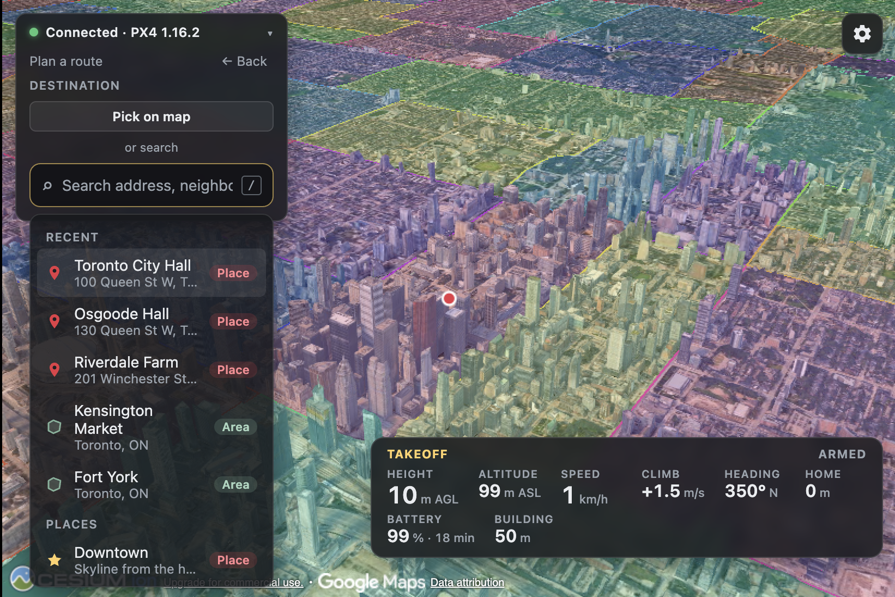
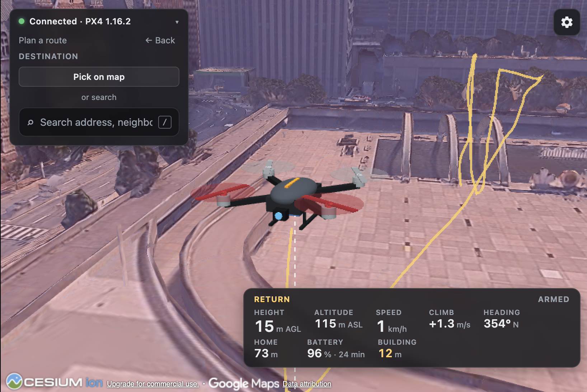

# TDot Drone Sim

A drone simulator set in a 3D City of Toronto.





| Part | What it is | Where |
|---|---|---|
| Frontend | React + TypeScript + CesiumJS: photorealistic 3D Toronto, City of Toronto data layers, place search | [frontend/](frontend/) |
| Flight sim | PX4 autopilot in software-in-the-loop mode with PX4's built-in physics (SIH), in Docker | [sim/px4/](sim/px4/), [docker-compose.yml](docker-compose.yml) |
| Bridge | Python + MAVSDK: PX4 telemetry → WebSocket for the app, commands back to PX4 | [sim/bridge/](sim/bridge/) |

## Frontend

See [frontend/README.md](frontend/README.md). In short:

```bash
cd frontend
npm install
cp .env.example .env.local   # add VITE_CESIUM_ION_TOKEN
npm run data                 # download + prepare City of Toronto data
npm run dev                  # http://localhost:5173
npm test                     # unit tests (Vitest)
```

Requires Node 20.19+ (see [frontend/.nvmrc](frontend/.nvmrc)).

## Flight sim (PX4 SITL)

Needs Docker Desktop. The image is built from Ubuntu 22.04 with PX4 v1.16.2, so it
runs natively on Apple Silicon and x86. PX4 runs headless with its built-in physics
(SIH); the 3D view is the React app. The build has two stages: PX4 is compiled in a
throwaway stage, and the image you run holds only the compiled simulator (~180 MB).
PX4's onboard flight logging is off by default (it writes gigabytes per session); set
`PX4_LOGGING=1` on the `px4` service to turn it on (logs land in `/px4/log`).

```bash
docker compose build         # first time only (PX4: clone + deps + compile; compile ~1 min on an M2)
docker compose up -d         # start PX4 (home: Nathan Phillips Square) + the bridge
docker compose logs -f       # PX4 and bridge output
docker compose down          # stop
```

Then open the app: the **Drone** panel's status turns green once it's connected, and
**Take off / Hold / Return / Land** command PX4 while the 3D view and HUD follow its
telemetry. (The app needs PX4 and the bridge running; there's no offline demo.) The bridge listens on `ws://localhost:8765` (localhost only).

Home position is set with `PX4_HOME_LAT` / `PX4_HOME_LON` / `PX4_HOME_ALT` (metres
above sea level) in [docker-compose.yml](docker-compose.yml).

### Crash and reset

PX4 doesn't know about buildings, so the app detects collisions (see
[frontend/README.md](frontend/README.md)) and sends `crash`: the bridge cuts the motors
and PX4's physics drops the drone. `reset` restarts PX4: the bridge sends a MAVLink
shutdown (PX4 SITL can't reboot itself), Docker's `restart: unless-stopped` starts it
again at home, and the bridge re-uploads the geofence. For this, the **bridge owns the
Docker network** and PX4 joins it (`network_mode: service:bridge`), so PX4 restarting
doesn't take the bridge's network down.

Don't run `bridge_test.py` with the app open: the app's collision check would react to
the test drone (and could cut its motors).

### Sim config

The simulated drone's settings live in the bridge, which saves them (in the
`bridge-config` Docker volume) and applies them to PX4's parameters whenever PX4
(re)connects and whenever they change, even mid-flight. Change them in the app under
**Settings → Simulation**; they're sent as a `config` command and the bridge checks them
first (ranges, and battery levels in order). Defaults are PX4's own, apart from the battery
and failsafes:

| Setting | Default | PX4 parameter |
| --- | --- | --- |
| Cruise speed (fly-to, routes, Return) | 5 m/s | `MPC_XY_CRUISE` |
| Climb / descent on autopilot | 3 / 1.5 m/s | `MPC_Z_V_AUTO_UP` / `_DN` (and the `MPC_Z_VEL_MAX_*` limits) |
| Take-off / landing speed | 1.5 / 0.7 m/s | `MPC_TKO_SPEED` / `MPC_LAND_SPEED` |
| Keyboard speed | 6 m/s | (the app's keyboard flying) |
| Battery: minutes of hovering, drain follows the load | 20 min, on | `SIM_BAT_DRAIN` (see Battery) |
| Battery levels: low / critical / emergency | 25 / 15 / 5% | `BAT_LOW_THR` / `BAT_CRIT_THR` / `BAT_EMERGEN_THR` |
| At critical: Return then land at emergency, land, or only warn | Return | `COM_LOW_BAT_ACT` |
| Geofence ceiling above home | 120 m | `GF_MAX_VER_DIST` |
| On a breach: Return, hold, land, or only warn | Return | `GF_ACTION` |
| After Return reaches home: land or hover | land | `RTL_LAND_DELAY` |

`FENCE_CEILING_M` and `BATTERY_FLIGHT_MIN` in `docker-compose.yml` set the defaults until
something is saved; `docker compose down -v` forgets the saved settings.

### Geofence

Whenever PX4 (re)connects, the bridge uploads the City of Toronto boundary as an
inclusion geofence with the ceiling above home (120 m by default; the drone limit is
122 m) and the breach action (Return by default) from the sim config. PX4 enforces it itself, with or without a browser open.
The fence comes from `frontend/public/data/toronto/boundary-fence.geojson` (made by
`npm run data`, mounted read-only into the bridge). PX4 stores at most 64 fence points,
so the boundary is simplified to ~50 points, within about 500 m of the true line.

### Return home height

PX4's Return mode climbs to its return height and flies **straight** home, without knowing
about buildings, and near home its "return cone" lets it come back lower still. So on every
(re)connect the bridge turns the cone off and sets a high, safe default (5 m under the
ceiling, 115 m by default). While the app is open it works out the safe height for the straight line from
the drone to home (10 m above the tallest City building on it) and sends it as `returnAlt`
every time it changes; PX4 climbs to it on the spot before heading home, whatever starts
the return (the Return button, a geofence breach, a PX4 failsafe). If a building on the way
is too tall to clear under that, the app warns in the drone panel. With the app closed,
PX4 keeps the last height it was given.

If PX4 takes over while you're flying with the keyboard (geofence, failsafe), the bridge
won't take control back until the keys are released, since re-entering offboard would
count as a pilot takeover and cancel PX4's failsafe.

### Battery

PX4's simulated battery drains while armed and refills when the drone disarms. Out of the
box it stops at 50%, so it never runs out, and it drains at one fixed rate whatever the
drone is doing. The bridge lets it run down to 0% and, about once a second, sets the drain
rate from the load: 20 minutes of hovering from full to empty (by default), about a third
of that rate idling armed on the ground, up to twice it climbing (at 4 m/s), a bit less
descending or cruising at ~8 m/s, and more again flying faster (turn "Drain follows the
load" off for a fixed rate). It also sets PX4's responses with time to act on them: a
warning at 25%, **Return home** at 15%, and **landing where it is** at 5% (over a building
that means onto the roof, which the app counts as a crash). PX4 does all of this itself,
app or no app. The app shows the minutes left in the HUD (estimated from how fast the
battery is dropping) and warns in the drone panel at each level.

Planned routes are checked before take-off: the app estimates the battery for the route
and for PX4's Return home from the last stop (with the same load model, at the configured
speeds) and refuses routes that would get home with less than the critical level. In the
sim, a short route came within a few percent: it arrived with 67% (62% predicted), and the
flight home used 34% (33% predicted). To try the limits, set a short battery under
Settings → Simulation.

### Smoke tests

Both check home is in Toronto, take off to 20 m and land. `flight_test.py` talks to PX4
directly over MAVLink; `bridge_test.py` goes through the bridge's WebSocket exactly as the
browser does: it checks the geofence is loaded and the 20 Hz state rate, flies forward
with keyboard-style velocity messages, checks the hover and hand-back to Hold, flies to a
point 60 m north, sets a return height and checks Return climbs to it before heading home,
checks bad sim settings are refused and a good one is saved and reported,
climbs into the 120 m ceiling and checks PX4 switches to Return, then crashes (motors cut:
it must fall and disarm) and resets (back at home, geofence re-uploaded, return height back
to the safe default):

```bash
docker run --rm --network container:tdot-px4 -v "$PWD/sim/tools:/tools:ro" \
  python:3.12-slim sh -c "pip install -q -r /tools/requirements.txt && python /tools/flight_test.py"

docker run --rm --network container:tdot-px4 -v "$PWD/sim/tools:/tools:ro" \
  python:3.12-slim sh -c "pip install -q -r /tools/requirements.txt && python /tools/bridge_test.py"
```

They use `mavsdk-grpc`, MAVSDK-Python's established API (the plain `mavsdk` package
switched to a different native API in v4). They run inside PX4's network namespace
because PX4 only sends MAVLink to localhost by default; the bridge does the same via
`network_mode: service:px4`. The bridge uses PX4's API link (UDP 14540) and the flight
test its ground-station link (14550), so both can run at once.

### How the pieces connect

```
PX4 SITL ──MAVLink/UDP──▶ bridge (MAVSDK) ──WebSocket──▶ React + Cesium app
         ◀── commands ───                  ◀── commands ──
```

WebSocket protocol (see [sim/bridge/bridge.py](sim/bridge/bridge.py)):

| Direction | Message |
|---|---|
| bridge → app | `{"type":"status","px4Connected":true,"px4Version":"1.16.2","geofence":{…},"returnAltM":99,"config":{…}}` on connect and on change (`config`: the sim settings) |
| bridge → app | `{"type":"state","state":{…}}` at 20 Hz, same fields as the app's `DroneState` |
| app → bridge | `{"type":"command","id":"…","action":"takeoff","altitudeM":30}` (`takeoff`, `land`, `rtl`, `hold`, `arm`, `disarm`, `goto` with `lat`/`lon`/optional `relAltM`, `crash`, `reset`, `returnAlt` with `relAltM`: Return's height, doesn't interrupt keyboard flying; `config` with some sim settings: checked, saved and applied, works without PX4) |
| bridge → app | `{"type":"ack","id":"…","ok":false,"error":"…"}` with PX4's reason if refused |
| app → bridge | `{"type":"velocity","forwardMs":5,"rightMs":0,"downMs":0,"yawRateDegS":0}` ~10 Hz while keys are held (keyboard flying; body frame, down positive) |
| bridge → app | `{"type":"notice","level":"error","message":"…"}` e.g. "Take off first" |

Keyboard flying uses PX4's offboard mode: the bridge streams the latest velocity at
20 Hz, hovers if input goes stale (0.5 s) and hands back to PX4 Hold after 3 s without
input (e.g. the tab was closed). Only non-zero input takes control, so the zeros sent
on key release can't override a command sent meanwhile.

## CI

GitHub Actions ([.github/workflows](.github/workflows)):

| Workflow | Runs on | Does |
|---|---|---|
| Frontend | changes under `frontend/` | lint, type-check, unit tests, production build |
| Flight sim | changes under `sim/` or `docker-compose.yml`, or manually | builds PX4 + bridge, fetches the geofence boundary, runs both smoke tests |

Dependabot opens weekly update PRs for npm, pip, the Docker base image and the Actions.
